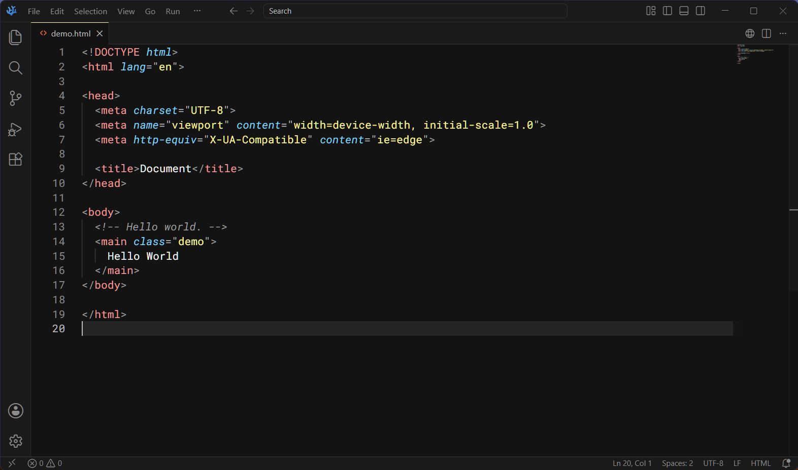

# Kaia Theme

A collection of dark Kaia color themes for Visual Studio Code, Ghostty, and
OpenCode.



## Variants

- **Kaia** uses a `#1a1a1a` background.
- **Kaia OLED** uses a `#000000` background.

The Ghostty and OpenCode variants otherwise share the same application-specific
colors. The VS Code extension also includes the historical **Kaia - Old** and
**Kaia Subtle - Old** variants for comparison.

## Applications

| Application | Themes | Files |
| --- | --- | --- |
| Visual Studio Code | Kaia, Kaia OLED, legacy variants | [`themes/`](themes/) |
| Ghostty | Kaia, Kaia OLED | [`ghostty/themes/`](ghostty/themes/) |
| OpenCode | Kaia, Kaia OLED | [`opencode/themes/`](opencode/themes/) |

## Installation

### Visual Studio Code

Package and install the extension from the repository root:

```sh
npm run install:vsix
```

### Ghostty

Copy both theme files into Ghostty's theme directory:

```sh
mkdir -p ~/.config/ghostty/themes
cp ghostty/themes/Kaia ghostty/themes/Kaia\ OLED ~/.config/ghostty/themes/
```

Set `theme = Kaia` or `theme = Kaia OLED` in your Ghostty configuration, then
reload the configuration.

### OpenCode

Copy both JSON files into OpenCode's theme directory:

```sh
mkdir -p ~/.config/opencode/themes
cp opencode/themes/kaia.json opencode/themes/kaia-oled.json ~/.config/opencode/themes/
```

Set `"theme": "kaia"` or `"theme": "kaia-oled"` in
`~/.config/opencode/tui.json`, then restart OpenCode.
